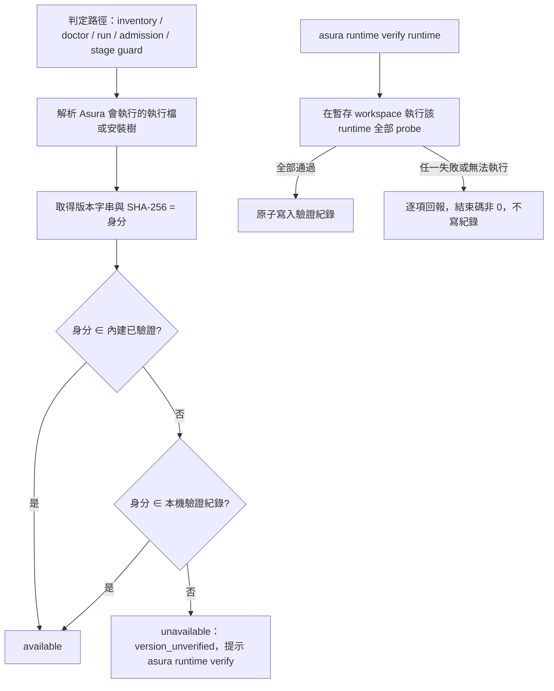

# Issue 73 實作計畫 - Runtime 版本改為「通過驗證即可使用」

風險與首要驗證見 [README](./README.md#風險與首要驗證)；現況見 [requirement-analysis.md](./requirement-analysis.md)；方案取捨見 [technical-analysis.md](./technical-analysis.md)。

## 設計方案

### 判定流程



### 介面（暫定，Phase 2 依 Phase 1 的結果定案）

```go
// internal/backend/verification
type Identity struct {
    Runtime string
    Version string
    Digest  string // OpenCode／Codex：執行檔 SHA-256；OMP／Antigravity：既有 hash 集合的摘要
}
type Record struct {
    Identity
    VerifiedAt   time.Time
    AsuraVersion string
}
func Load(path string) ([]Record, error)          // 每次判定重新讀檔，不快取
func Add(path string, r Record) error              // 寫暫存檔再 rename
func Remove(path string, id Identity) error        // 內建身分回錯誤
func Allowed(id Identity, builtin []Identity, records []Record) bool

type Probe interface {
    Name() string
    Run(ctx context.Context, workspace string) error // 失敗時回傳原因
}
func Verify(ctx context.Context, runtime string, probes []Probe) (Result, error)
```

## 使用方式對照

| 情境 | 變更前 | 變更後 |
|---|---|---|
| 升級 Codex 到 0.163.0 | `version_failed`，無法使用 | `version_unverified`；執行 `asura runtime verify codex` 通過後可用 |
| OpenCode 1.18.31 | inventory 顯示 available，daemon 拒絕 | 所有路徑都是 `version_unverified`，驗證後都可用 |
| 安裝內建版本 | 可用 | 可用（不需驗證） |
| 檢查紀錄 | 無 | `asura runtime verify --list`、`--remove` |

## 實作步驟

Task 由 decompose 於 2026-10-21 依核准 commit `64d7b0e` 細化。所有 probe 都經過 Asura 的 adapter 實際組出的命令執行，不直接呼叫 runtime CLI；唯讀 probe 一律搭配正向對照（同一個 prompt 在可寫模式下必須真的寫出檔案），避免「模型沒去嘗試」造成的假綠燈。

## Phase 1 — probe 在新版本上可信（首要驗證，README「風險與首要驗證」）

### Task 1.1 — Codex probe 在 0.163.0 上的可信度
- 產出與範圍：在 worktree 以測試層暫時放行已安裝版本，透過 codex adapter 實際組出的命令執行唯讀、workspace-write、輸出解析、取消四個 probe；紀錄存 `evidence/phase1-codex.md`。不進產品判定
- 相依：無
- 驗收編號：SCN-005（風險證據）
- 完成判準：四個 probe 在 0.163.0 各有明確結果；唯讀 probe 的正向對照（workspace-write 下同一 prompt 寫出檔案）成立；沙箱失效對照組（adapter 以可寫模式執行唯讀角色）讓唯讀 probe 失敗；記錄模型呼叫次數、耗時與登入條件
- 驗證：live 實跑加對照組；被跳過或無法得出結果的 probe 照實記錄，不計為通過
- 狀態：✅ 已完成（probe 可信；cancellation 抓到既有問題 #74）
- 證據：[evidence/phase1-probes.md](./evidence/phase1-probes.md)：0.163.0 與內建 0.155.0 的 output／workspace-boundary／read-only 皆 PASS、cancellation 皆 FAIL；兩組失效對照組都讓對應 probe 失敗

### Task 1.2 — OpenCode probe 在 1.18.31 上的可信度
- 產出與範圍：新寫 OpenCode 唯讀與寫入角色的 probe（目前只有輸出解析的 live 測試），透過 opencode adapter 的唯讀隔離設定與寫入設定執行；另含輸出解析、取消；紀錄存 `evidence/phase1-opencode.md`
- 相依：無
- 驗收編號：SCN-005（風險證據）
- 完成判準：同 Task 1.1；沙箱失效對照組為「唯讀角色改用寫入設定」
- 驗證：同 Task 1.1
- 狀態：✅ 已完成（probe 可信；抓到既有問題 #74、#75）
- 證據：[evidence/phase1-probes.md](./evidence/phase1-probes.md)：1.18.31 與內建 1.18.23 的 output／read-only 皆 PASS、workspace-boundary 與 cancellation 皆 FAIL；唯讀失效對照組讓 read-only 失敗

### Task 1.3 — OMP／Antigravity probe 的可信度
- 產出與範圍：在 Asura 的 bwrap 內執行輸出解析、取消、登入憑證邊界 probe；Antigravity 目前因 hash 不符而 unavailable，在 worktree 暫時以本機安裝的 hash 放行；紀錄存 `evidence/phase1-clisandbox.md`
- 相依：無
- 驗收編號：SCN-005（風險證據）
- 完成判準：每個 probe 有明確結果；憑證邊界 probe 有失效對照組（例如憑證以可寫方式掛入時 probe 失敗）；記錄模型呼叫次數與耗時
- 驗證：live 實跑加對照組
- 狀態：✅ 已完成（2026-10-22）
- 證據：[evidence/phase1-probes.md](./evidence/phase1-probes.md)「2026-10-22 重跑」：OMP 18.12.6、Antigravity 1.4.4 全部 probe PASS；workspace 與憑證兩組 bwrap 失效對照組皆失敗；新增主動的 credential-boundary probe，取消 probe 改以啟動標記判定，兩者都有 hermetic 紅燈；2026-10-21 Antigravity 的「登入過期」是 snap 版 go 讓 libsecret 查不到 keyring 的假象

### Task 1.4 — Phase 1 判定
- 產出與範圍：彙整 Task 1.1～1.3，寫回 README「風險與首要驗證」的完成證據；列出每個 runtime 驗證一次的模型呼叫次數與所需條件
- 相依：Task 1.1、1.2、1.3
- 驗收編號：風險證據
- 完成判準：每個唯讀 probe 都有實際失敗的沙箱失效對照組；若有 probe 在新版本上得不出可信結果，停止 Phase 2 以後的工作，依 acceptance.md「逐題確認」交由使用者決定
- 驗證：人工核對證據檔與對照組
- 狀態：✅ 已完成（2026-10-22）
- 證據：[evidence/phase1-probes.md](./evidence/phase1-probes.md)：四個 runtime 的 probe 在已安裝版本上都得出可信結果，每個沙箱相關 probe（read-only、workspace-boundary、credential-boundary）都有實際失敗的失效對照組；沒有 probe 得不出可信結果，不需要停止。Codex、OpenCode 的失敗是真實缺陷（#74、#75，TBD-6），不是 probe 失準。每個 runtime 一輪 4 次模型呼叫、約 30～40 秒，所需條件見同檔「模型呼叫次數與所需條件」

## Phase 2 — 身分、紀錄與一致的判定

### Task 2.1 — 驗證紀錄與身分計算
- 產出與範圍：`internal/backend/verification`：身分（版本 + SHA-256）計算、紀錄讀取、原子寫入（暫存檔再 rename，`0600`）、移除、權限不安全時拒絕讀取；`internal/config` 提供 `$XDG_DATA_HOME/asura/` 下的固定路徑
- 相依：Task 1.1、1.2（2026-10-21 由 Task 1.4 收窄：紀錄與身分計算不依賴 probe 結果；OMP／Antigravity probe 的可信度只影響 Task 3.1，Task 1.3 因登入過期阻塞）
- 驗收編號：支援 SCN-003、SCN-006、SCN-007
- 完成判準：hermetic 單元測試覆蓋新增、重複新增、移除、內建身分不能移除、檔案損毀與權限不安全；路徑不受 `--db` 與 config 有無影響
- 驗證：單元測試先紅後綠，期望值為字面值
- 狀態：✅ 已完成
- 證據：[evidence/task-2.1.md](./evidence/task-2.1.md)：6 個單元測試先紅後綠；專案 gate 24 個套件 ok

### Task 2.2 — OpenCode／Codex 改為身分比對
- 產出與範圍：兩個 adapter 的清冊 probe 與 `ValidateVersion` 改為「內建或已驗證」判定，計算已解析執行檔的 SHA-256；清冊新增 reason `version_unverified` 並加入白名單，policy 維持 `inventory-v1`
- 相依：Task 2.1
- 驗收編號：支援 SCN-001、SCN-002、SCN-006
- 完成判準：以假執行檔產生內建、未驗證、已驗證、版本相同但內容不同四種身分，清冊與 Run 前檢查結果正確；`version_failed` 只用在版本取不到或格式錯
- 驗證：hermetic 單元測試
- 狀態：✅ 已完成
- 證據：[evidence/task-2.2.md](./evidence/task-2.2.md)：3 個身分測試先紅後綠；本機 Codex 0.163.0、OpenCode 1.18.31 為 `version_unverified`，內建 1.18.23 為 available；專案 gate 24 個套件 ok

### Task 2.3 — OMP／Antigravity 改為內建或已驗證的 hash 集合
- 產出與範圍：`clisandbox` 的 pinned file probe 與 Run 前的安裝樹 hash 檢查，改為接受內建 hash 集合或已驗證的 hash 集合；不符時回 `version_unverified`
- 相依：Task 2.1
- 驗收編號：支援 SCN-001、SCN-002、SCN-006
- 完成判準：同 Task 2.2 的四種身分；既有的 `TestRuntimePinnedAcrossSourceUpdate` 等測試維持通過
- 驗證：hermetic 單元測試
- 狀態：✅ 已完成
- 證據：[evidence/task-2.3.md](./evidence/task-2.3.md)：2 個身分測試先紅後綠；本機 OMP 18.4.4 維持 available、Antigravity 1.4.4 為 `version_unverified`；專案 gate 24 個套件 ok

### Task 2.4 — 所有判定路徑一致
- 產出與範圍：移除 `internal/daemon/daemon.go:154-155,231`、`cmd/asura/inventory.go:34-35`、`cmd/asura/run.go:422-423` 寫死的版本與前綴；doctor 對 `version_unverified` 顯示 `asura runtime verify <runtime>` 提示
- 相依：Task 2.2、2.3
- 驗收編號：SCN-001、SCN-002、SCN-006、SCN-008
- 完成判準：四種身分在 runtime inventory、doctor、本機 run（含 `--backend auto`）、daemon admission 的結果一致；未驗證時 explicit 不建立 Task、auto 排除該 runtime；`rg` 找不到殘留的寫死版本
- 驗證：整合測試（假執行檔 + 真 CLI／daemon），先紅後綠
- 狀態：✅ 已完成
- 證據：[evidence/task-2.4.md](./evidence/task-2.4.md)：`TestRuntimeVerificationAcrossPaths` 先紅後綠，四條路徑在五個階段結果一致；專案 gate 24 個套件 ok

### Task 2.5 — 紀錄移除後的 stage 執行前檢查與舊封存相容
- 產出與範圍：確認 stage guard 在紀錄移除後拒絕執行且不改選；升級前封存（policy `inventory-v1`、不含新 reason）的 cron 與排隊任務仍通過 `InventorySnapshot.Validate`
- 相依：Task 2.4
- 驗收編號：SCN-009
- 完成判準：daemon 接受任務後移除紀錄，該 stage 被拒絕、沒有模型呼叫、沒有改選；以舊格式封存的 fixture 通過驗證
- 驗證：整合測試
- 狀態：✅ 已完成
- 證據：[evidence/task-2.5.md](./evidence/task-2.5.md)：`TestRuntimeVerificationRemovedBeforeStage`（三組反向對照皆失敗）與 `TestInventorySnapshotBeforeVersionVerificationStillValid`（main 上抓取的升級前快照；調升 policy 的對照失敗）；專案 gate 24 個套件 ok

## Phase 3 — `asura runtime verify` 命令

### Task 3.1 — probe 產品化
- 產出與範圍：把 Phase 1 驗證過的 probe 從 `_test.go` 搬成產品程式（每個 runtime 一組，含正向對照），在 Asura 建立的暫存 workspace 執行；原本的 live 測試改為呼叫同一套 probe。2026-10-22 Task 1.3 補充：OMP 紀錄的 `tree_sha256` 必須以 `clisandbox.TreeHash` 計算（與執行時 `SnapshotTree` 相同）；OMP、Antigravity 加入 credential-boundary probe
- 相依：Task 1.4、Task 2.2、Task 2.3
- 驗收編號：SCN-005
- 完成判準：以 fake runtime 模擬「唯讀角色能寫入」時唯讀 probe 失敗；模擬「模型沒有讀出 workspace 的 nonce」時正向對照失敗，不會被當成通過。2026-10-22 修訂：原文為「模型沒有嘗試寫入」，但實測沙箱正常時 OpenCode（唯讀 agent 沒有 bash）與 Codex（事先判斷不能寫）都不會嘗試寫入，以此為條件會讓唯讀 probe 永遠失敗；改以同一唯讀回合讀出 nonce 為正向對照，「被允許時會寫入」由同一輪的 workspace-boundary 證明，理由與實測見證據
- 驗證：hermetic 測試（fake runtime）；live 測試保留為可選並記錄 SKIP
- 狀態：✅ 已完成（2026-10-22）
- 證據：[evidence/task-3.1.md](./evidence/task-3.1.md)：`Spec`／`Prepare`／`Verify` 與四個 runtime 的 `VerificationSpec`，hermetic 測試先紅後綠；live 經 `Verify` 實跑，OMP、Antigravity 全過，Codex、OpenCode 的唯讀 probe 通過、失敗項為已知的 #74、#75；失效對照組皆失敗；專案 gate 24 個套件 ok

### Task 3.2 — verify 命令的成功與失敗
- 產出與範圍：`asura runtime verify <runtime>`：依序執行該 runtime 的 probe，全部通過才寫入紀錄；逐項印出結果；任一失敗或無法執行時結束碼非 0、不寫紀錄
- 相依：Task 2.1、Task 3.1
- 驗收編號：SCN-003、SCN-004
- 完成判準：fake runtime 覆蓋全部通過、單一 probe 失敗、無法執行（未登入、逾時、bwrap 不可用）；失敗時既有紀錄逐 byte 不變；通過後以不同 `--db`、有無 config 檢查皆為 available
- 驗證：整合測試，先紅後綠
- 狀態：✅ 已完成（2026-10-22）
- 證據：[evidence/task-3.2.md](./evidence/task-3.2.md)：`TestRuntimeVerifyCommand` 先紅後綠，涵蓋全部通過、單一 probe 失敗、未登入、bwrap 不可用、未安裝、內建身分；逾時由 `TestVerify` 在 verification 層覆蓋（理由見證據）；兩項突變檢查都被抓到；專案 gate 24 個套件 ok

### Task 3.3 — `--list` 與 `--remove`
- 產出與範圍：列出紀錄並標出內建身分；移除指定紀錄；移除內建身分時失敗且紀錄不變
- 相依：Task 3.2
- 驗收編號：SCN-007
- 完成判準：三種情況以字面輸出斷言；移除後該身分回到 `version_unverified`
- 驗證：整合測試
- 狀態：✅ 已完成（2026-10-22）
- 證據：[evidence/task-3.3.md](./evidence/task-3.3.md)：`TestRuntimeVerifyListRemove` 先紅後綠，以 stdout／stderr 全文斷言列出、移除與拒絕移除內建身分；移除後回到 `version_unverified`；突變檢查被抓到；專案 gate 24 個套件 ok

### Task 3.4 — 驗證不自動觸發
- 產出與範圍：以會記錄呼叫的 fake runtime 確認 daemon 啟動、doctor、runtime inventory、run、ask 都不執行 probe
- 相依：Task 3.2
- 驗收編號：SCN-010
- 完成判準：各命令執行後 fake runtime 沒有 probe 呼叫紀錄；未驗證時只回報 `version_unverified` 與提示
- 驗證：整合測試；反向檢查為在某條路徑暫時接上 probe，測試必須失敗
- 狀態：✅ 已完成（2026-10-22）
- 證據：[evidence/task-3.4.md](./evidence/task-3.4.md)：`TestRuntimeVerificationNotAutomatic` 從 daemon 啟動前開始記錄 Codex 與 OpenCode 的所有呼叫，六條路徑都只有 `--version`；反向檢查把 probe 接到 doctor 或 daemon 啟動時測試都失敗；專案 gate 24 個套件 ok

### Task 3.5 — 本機真實 runtime 端到端
- 產出與範圍：在維護者主機上以 `asura runtime verify` 驗證 OMP 18.12.6 與 Antigravity 1.4.4，之後以本機 `run` 與 daemon `ask` 各跑一個任務；紀錄存 `evidence/e2e.md`
- 範圍修訂（2026-10-27 Q16）：原本指定 Codex 0.163.0 與 OpenCode 1.18.31，兩者要等 [#74](https://github.com/raybird/Asura/issues/74)、[#75](https://github.com/raybird/Asura/issues/75) 修好才通過得了驗證；改用目前驗證得過、同樣不是內建身分的 OMP 與 Antigravity 走同一流程。Codex 與 OpenCode 的端到端在 #74、#75 驗收時補做
- 相依：Task 2.4、Task 3.3
- 驗收編號：支援 SCN-003（SCN-008 指 OpenCode，它的端到端移到 #75 驗收時補做）
- 完成判準：驗證前兩者在四條判定路徑皆為 `version_unverified`；驗證後皆為 available，daemon 任務成功；移除紀錄後回到 `version_unverified`
- 驗證：live 端到端，記錄命令與輸出
- 狀態：✅ 已完成（2026-10-27）
- 證據：[evidence/e2e.md](./evidence/e2e.md)

## Phase 4 — 文件

### Task 4.1 — 版本政策與命令文件
- 產出與範圍：`docs/guides/runtimes.md`、`docs/guides/cli-reference.md`、README 的 runtime 表與指令一覽、CHANGELOG `[Unreleased]`；修正 requirement-analysis「問題點總結」第 3 點列出的不一致
- 相依：Task 3.5
- 驗收編號：交付成果（project.md 常青文件）
- 完成判準：文件描述的版本政策、reason、命令與紀錄位置和程式一致；README 指令一覽列出 `runtime verify`
- 驗證：人工核對文件與程式，記錄比對範圍
- 狀態：✅ 已完成（2026-10-27）
- 證據：[evidence/task-4.1.md](./evidence/task-4.1.md)：逐項核對文件敘述與程式依據；錨點與相對連結檢查；專案 gate 24 個套件 ok

## Phase 5 — 審查修正（2026-10-27，PR #77 審查）

### Task 5.1 — OpenCode 跨路徑整合測試（MUST FIX 1）
- 產出與範圍：`cmd/asura` 的整合測試以假 opencode 1.18.31 走五個階段：未驗證、寫入紀錄後四條路徑 available 且 run／ask 實際執行假 opencode、換掉執行檔、移除紀錄；修正 `TestRuntimeVerificationAcrossPaths` 註解、task-2.4.md 與 e2e.md 對 SCN-008 的描述
- 相依：無
- 驗收編號：SCN-008
- 完成判準：拿掉 daemon、`localBackend`、`run.go` auto 任一處 OpenCode 的 `VerificationPath` 時測試失敗；還原後通過
- 驗證：整合測試加突變紅燈
- 狀態：✅ 已完成（2026-10-27）
- 證據：[evidence/phase5.md](./evidence/phase5.md) Task 5.1：三處接線各自的突變都讓測試失敗

### Task 5.2 — Codex 唯讀沙箱的確定性檢查（Q17）
- 產出與範圍：Codex 的唯讀 probe 另以 `codex sandbox` 直接執行寫 workspace 的命令：唯讀 policy 必須失敗、workspace-write 必須成功；不經模型
- 相依：無
- 驗收編號：SCN-005
- 完成判準：hermetic 測試以假 codex 覆蓋「沙箱沒擋」「正向對照失敗」「通過」；live 對照組（shim 讓唯讀 sandbox 改用 workspace-write）讓該檢查失敗
- 驗證：hermetic 紅綠加 live 對照組
- 狀態：✅ 已完成（2026-10-27）
- 證據：[evidence/phase5.md](./evidence/phase5.md) Task 5.2：hermetic 紅綠；真實 Codex 0.163.0 通過，三組失效對照都失敗

### Task 5.3 — Antigravity 先比雜湊（Q18）
- 產出與範圍：`antigravity.admit` 非內建雜湊時先以雜湊查紀錄，沒有相符就 `version_unverified`、不執行 agy；有相符則用紀錄的版本
- 相依：無
- 驗收編號：SCN-002、SCN-006
- 完成判準：未驗證、雜湊不符時假 agy 完全沒被執行；有紀錄時 available 且版本取自紀錄
- 驗證：單元測試紅綠
- 狀態：✅ 已完成（2026-10-27）
- 證據：[evidence/phase5.md](./evidence/phase5.md) Task 5.3：判定時假 agy 完全沒被執行（改之前有三次 `--version`）

### Task 5.4 — 改善建議（Q19）
- 產出與範圍：Codex 雜湊改用 `clisandbox.TreeHash`，移除 `verification.TreeDigest`；verify 在跑 probe 前先讀紀錄檔，失敗立即結束；過時註解與開頭提示文字；runtimes.md 寫明 OMP 換 node_modules 樹的表現；PR Proof 表 SCN-001 的引用
- 相依：無
- 驗收編號：SCN-004、SCN-006、常青文件
- 完成判準：紀錄檔不安全時 verify 不呼叫 runtime 就以非 0 結束（測試先紅）；Codex 身分測試照常通過
- 驗證：單元／整合測試；文件人工核對
- 狀態：✅ 已完成（2026-10-27）
- 證據：[evidence/phase5.md](./evidence/phase5.md) Task 5.4：兩項新測試先紅後綠；專案 gate 24 個套件 ok

### 責任對照

| 驗收／交付 | 責任 Task | 支援 |
|---|---|---|
| 風險證據 | 1.4 | 1.1、1.2、1.3 |
| SCN-001 | 2.4 | 2.2、2.3 |
| SCN-002 | 2.4 | 2.2、2.3 |
| SCN-003 | 3.2 | 2.1、3.5 |
| SCN-004 | 3.2 | — |
| SCN-005 | 3.1 | 1.1、1.2、1.3 |
| SCN-006 | 2.4 | 2.1、2.2、2.3 |
| SCN-007 | 3.3 | 2.1 |
| SCN-008 | 2.4 | — |
| SCN-009 | 2.5 | — |
| SCN-010 | 3.4 | — |
| 常青文件 | 4.1 | — |

## 測試策略與驗收對應

| 驗收 | 層級 | 策略 |
|---|---|---|
| SCN-001、SCN-002、SCN-006、SCN-008 | 單元 + 整合 | hermetic：以假執行檔產生不同身分，逐一對 inventory、doctor、run、daemon admission 斷言結果與 reason |
| SCN-003、SCN-004、SCN-007 | 整合 | fake runtime 控制 probe 結果；紀錄檔內容與權限以字面值斷言 |
| SCN-005 | live + 對照組 | Phase 1 的沙箱失效對照組；產品化後保留為可選的 live 測試 |
| SCN-009 | 整合 | 以 daemon 接受任務後移除紀錄，斷言 stage 執行前被拒絕且沒有模型呼叫 |
| SCN-010 | 整合 | 以會記錄呼叫的 fake runtime 確認 daemon、doctor、inventory、run、ask 都不觸發 probe |

依 project.md：live／contract 測試在前置條件缺少時會 `t.Skip`，被跳過的測試名稱與原因寫進證據，不計為通過。

## 檢查清單

- [x] Phase 1 的對照組證明每個唯讀 probe 抓得到沙箱失效（[phase1-probes.md](./evidence/phase1-probes.md)、Task 1.4）
- [x] TBD-1～TBD-4 已有結論（2026-10-21）
- [x] SCN-001～SCN-010 已核准（2026-10-21）
- [x] 升級前封存的 cron 與排隊任務在新版本仍通過 `InventorySnapshot.Validate`（[task-2.5.md](./evidence/task-2.5.md)）
- [x] 所有判定路徑共用同一個判定函式，沒有殘留寫死的版本或前綴（四個 adapter 都經 `verification.Admit`；2026-10-27 搜尋程式碼，沒有 `1.18` 前綴比對；[task-2.4.md](./evidence/task-2.4.md)）
- [x] 紀錄檔以原子方式寫入，權限 `0600`（flock 加 tmp＋rename，[task-2.1.md](./evidence/task-2.1.md)；真實檔案權限見 [e2e.md](./evidence/e2e.md)）
- [x] 文件與程式的版本政策一致（[task-4.1.md](./evidence/task-4.1.md)）
