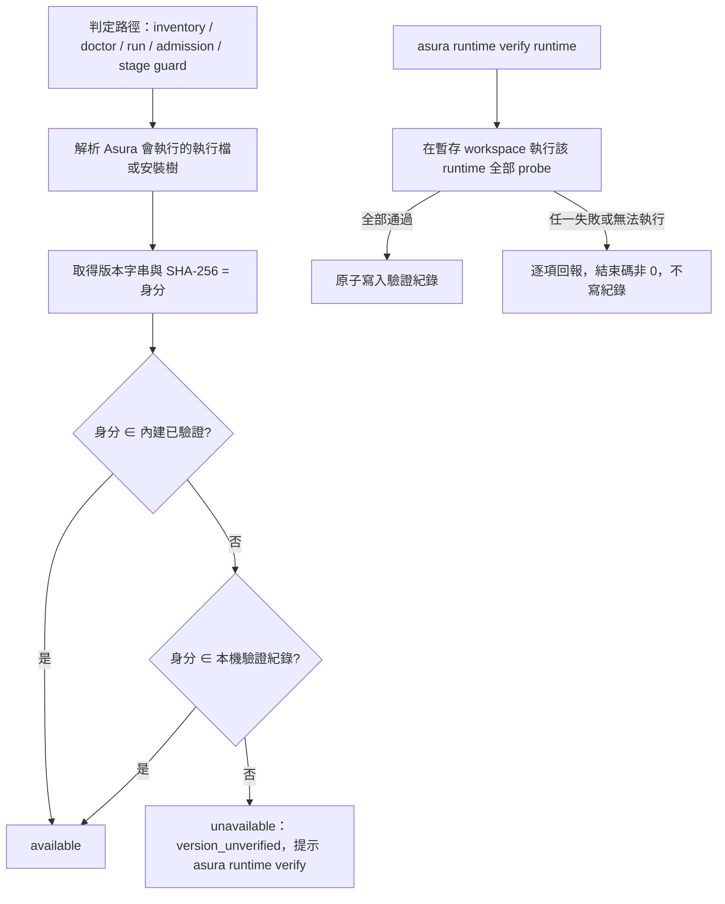

# Issue 73 實作計畫 - Runtime 版本改為「通過驗證即可使用」

風險與首要驗證見 [README](./README.md#風險與首要驗證)；現況見 [requirement-analysis.md](./requirement-analysis.md)；方案取捨見 [technical-analysis.md](./technical-analysis.md)。

## 設計方案

### 判定流程



### 介面（暫定，Phase 2 依 Phase 1 的結果定案）

```go
// internal/backend/verification
type Identity struct {
    Runtime string
    Version string
    Digest  string // OpenCode／Codex：執行檔 SHA-256；OMP／Antigravity：既有 hash 集合的摘要
}
type Record struct {
    Identity
    VerifiedAt   time.Time
    AsuraVersion string
}
func Load(path string) ([]Record, error)          // 每次判定重新讀檔，不快取
func Add(path string, r Record) error              // 寫暫存檔再 rename
func Remove(path string, id Identity) error        // 內建身分回錯誤
func Allowed(id Identity, builtin []Identity, records []Record) bool

type Probe interface {
    Name() string
    Run(ctx context.Context, workspace string) error // 失敗時回傳原因
}
func Verify(ctx context.Context, runtime string, probes []Probe) (Result, error)
```

## 使用方式對照

| 情境 | 變更前 | 變更後 |
|---|---|---|
| 升級 Codex 到 0.163.0 | `version_failed`，無法使用 | `version_unverified`；執行 `asura runtime verify codex` 通過後可用 |
| OpenCode 1.18.31 | inventory 顯示 available，daemon 拒絕 | 所有路徑都是 `version_unverified`，驗證後都可用 |
| 安裝內建版本 | 可用 | 可用（不需驗證） |
| 檢查紀錄 | 無 | `asura runtime verify --list`、`--remove` |

## 實作步驟

Phase 為規劃粒度；Task 由 decompose 在本檔細化。

1. 📝 **Phase 1：probe 在新版本上的可信度**（SCN-005；首要驗證）
   - 內容：把現有 live probe 的版本條件改為「對已安裝版本執行」（只在 worktree 或測試層，不進產品判定），以本機 Codex 0.163.0、OpenCode 1.18.31、OMP、Antigravity 實跑；每個唯讀 probe 各做一組沙箱失效對照組（例如拿掉唯讀旗標、改用可寫設定），確認 probe 會失敗
   - 相依：無
   - 完成判準：README「風險與首要驗證」的完成證據成立；記錄每個 probe 的模型呼叫次數、登入條件與耗時；若某個 probe 在新版本上無法得出可信結果，停止後續 Phase，回報並交由使用者決定
2. 📝 **Phase 2：身分、紀錄與判定**（SCN-001、SCN-002、SCN-006、SCN-008、SCN-009、SCN-010）
   - 內容：`internal/backend/verification` 的身分計算與紀錄讀寫；各 runtime 的 probe／ValidateVersion 改為身分比對；新增 `version_unverified`；移除 daemon 與 CLI 寫死的版本與前綴；清冊 policy 維持 `inventory-v1`，只擴充 reason 白名單（Q13）
   - 相依：Phase 1
   - 完成判準：各判定路徑對內建、未驗證、已驗證、執行檔被替換四種身分的結果一致，並有 hermetic 測試；既有測試全綠
3. 📝 **Phase 3：`asura runtime verify` 命令**（SCN-003、SCN-004、SCN-005、SCN-007）
   - 內容：probe 從 `_test.go` 搬成產品程式並由命令編排；`--list`、`--remove`；原本的 live 測試改為呼叫同一套 probe
   - 相依：Phase 2
   - 完成判準：以 fake runtime 覆蓋全部通過、單一 probe 失敗、無法執行三種情況；以本機真實 runtime 跑一次端到端驗證，驗證後 daemon 路徑可用
4. 📝 **Phase 4：文件與收尾**
   - 內容：`docs/guides/runtimes.md`、`docs/guides/cli-reference.md`、README 的 runtime 表與指令一覽、CHANGELOG `[Unreleased]`
   - 相依：Phase 3
   - 完成判準：文件描述的版本政策與程式一致；修正 requirement-analysis「問題點總結」第 3 點列出的不一致

## 測試策略與驗收對應

| 驗收 | 層級 | 策略 |
|---|---|---|
| SCN-001、SCN-002、SCN-006、SCN-008 | 單元 + 整合 | hermetic：以假執行檔產生不同身分，逐一對 inventory、doctor、run、daemon admission 斷言結果與 reason |
| SCN-003、SCN-004、SCN-007 | 整合 | fake runtime 控制 probe 結果；紀錄檔內容與權限以字面值斷言 |
| SCN-005 | live + 對照組 | Phase 1 的沙箱失效對照組；產品化後保留為可選的 live 測試 |
| SCN-009 | 整合 | 以 daemon 接受任務後移除紀錄，斷言 stage 執行前被拒絕且沒有模型呼叫 |
| SCN-010 | 整合 | 以會記錄呼叫的 fake runtime 確認 daemon、doctor、inventory、run、ask 都不觸發 probe |

依 project.md：live／contract 測試在前置條件缺少時會 `t.Skip`，被跳過的測試名稱與原因寫進證據，不計為通過。

## 檢查清單

- [ ] Phase 1 的對照組證明每個唯讀 probe 抓得到沙箱失效
- [x] TBD-1～TBD-4 已有結論（2026-10-21）
- [x] SCN-001～SCN-010 已核准（2026-10-21）
- [ ] 升級前封存的 cron 與排隊任務在新版本仍通過 `InventorySnapshot.Validate`
- [ ] 所有判定路徑共用同一個判定函式，沒有殘留寫死的版本或前綴
- [ ] 紀錄檔以原子方式寫入，權限 `0600`
- [ ] 文件與程式的版本政策一致
